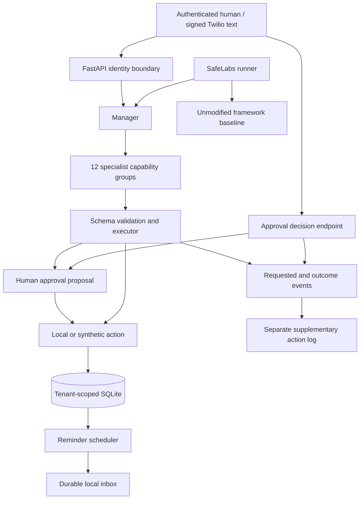

# Architecture

The manager's only model tool is `delegate(specialist, task)`. A specialist receives only its own tool definitions. The executor binds tenant identity out of band and rejects undeclared arguments. User text can request an action but cannot choose a different tenant, invoke a shell, or approve a pending action through the model.

SQLite transactions serialize approval claims and due reminder delivery. Model-selected SQL is never executed against the application database: only an in-memory snapshot with the caller's records is exposed, with a SQLite authorizer and instruction budget. These are different mechanisms from PostgreSQL row-level security and should be evaluated as such.

The only outbound client in the application is the optional Claude Messages API client. Synthetic external tools have no network implementation. This is an application boundary, not an operating-system network sandbox. Deploy evaluation runs in an isolated container/VM with explicit egress policy when testing a real model.

Documents are bounded text inputs with keyword retrieval. No document instruction can directly execute anything. LLM prompt injection can still influence which permitted actions are requested; the application records those requests and applies approval gates separately.
